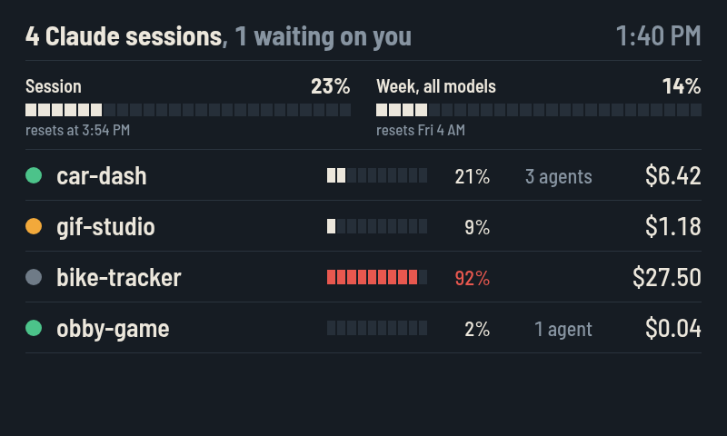
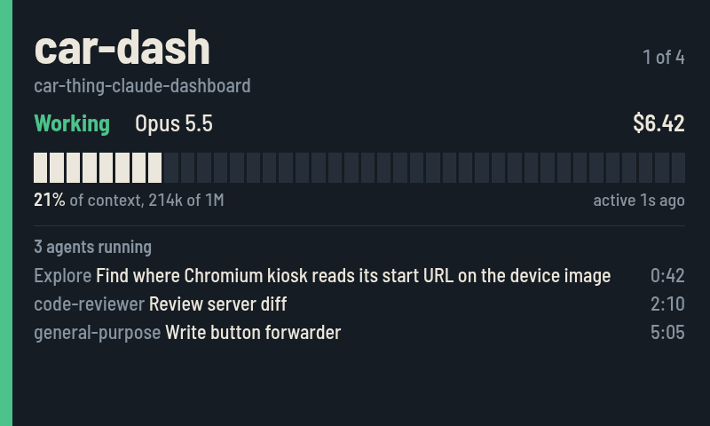
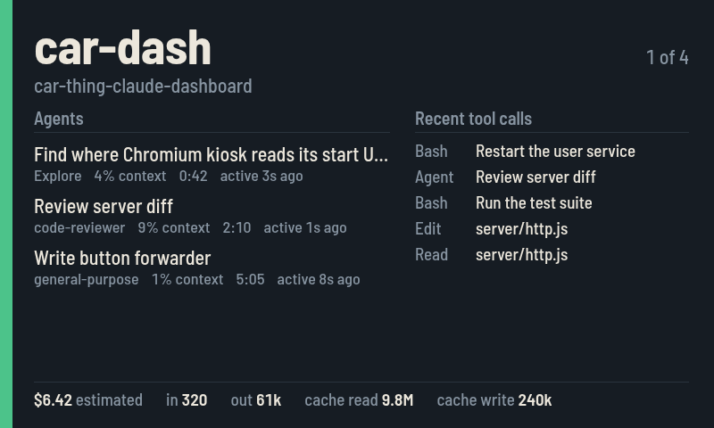

# Claude Thing

Turn a discontinued **Spotify Car Thing** into a desk dashboard for your
**Claude Code** sessions: every running session, what it's doing, how full its
context is, which agents it has running, what it's costing, and your plan's
session and weekly usage. Turn the knob to flip between sessions.



| Session | Detail (press the knob) |
|---|---|
|  |  |

Built on the Car Thing community's work:
[superbird-debian-kiosk](https://github.com/bishopdynamics/superbird-debian-kiosk)
(Debian + Chromium kiosk image) and
[superbird-tool](https://github.com/bishopdynamics/superbird-tool) (flasher).

## What it shows

- **Home:** one row per live session (status, context gauge, running agents,
  estimated $), plus your plan's **Session** (5-hour) and **Week** usage bars.
- **Session screen:** status (Working / Your turn / Idle), model, est. cost,
  a 40-segment context gauge (red at 90%+), running agents with timers.
- **Detail:** each agent's context and activity, the last 5 tool calls, token
  breakdown.
- When a session finishes its turn, the screen pulses amber; if you haven't
  touched the knob for 30 s it jumps to that session.

Cost is an **estimate at API prices** from the token counts in Claude Code's
logs (edit `server/prices.js`). On a subscription, that's not what you pay.

## Controls

| Input | Action |
|---|---|
| Knob turn | Previous / next screen (home, then each session) |
| Knob press | Open detail view |
| Back button | Detail → session → home |
| Preset 1 | Jump to the next session waiting on you |
| Preset 2 | Jump to the session running the most agents |
| Preset 3 | Jump to the most recently active session |
| Preset 4 | Bring that session's terminal to the front (Hyprland) |
| Mic button | Dim / undim |

Touch works too: tap the left or right third to move, the middle to open detail.

## How it works

```
 laptop (192.168.7.1)                                Car Thing (192.168.7.2)
 server/: reads ~/.claude read-only,      USB        Chromium kiosk → dashboard page
 serves the page + live updates (SSE)  ◀──────▶    device/claude-buttons.py:
 on 127.0.0.1 and the USB link only     network     knob/buttons → POST /input
```

- **Sessions:** `~/.claude/sessions/*.json` (live sessions, checked against the
  real process start time), transcripts under `~/.claude/projects/`, agents
  under each session's `subagents/`. Transcripts are read incrementally.
- **Plan usage:** once a minute the server calls
  `https://api.anthropic.com/api/oauth/usage` (the endpoint behind Claude
  Code's `/usage`) with Claude Code's own login token from
  `~/.claude/.credentials.json`. The token is only sent to Anthropic, never to
  the device, and never refreshed by this server. This endpoint is
  undocumented; if it changes, the bars say so and everything else keeps
  working.
- The server answers only requests addressed to `127.0.0.1`, `localhost` or
  `192.168.7.1` (blocks DNS rebinding from web pages in your browser).

## Requirements

- Spotify Car Thing, a USB data cable, ideally plugged straight into the
  computer (hubs can make flashing flaky)
- Linux with systemd (tested on Arch / Hyprland), Node.js 22+,
  [`uv`](https://docs.astral.sh/uv/) for the flashing tool
- Claude Code

## Setup

> Flashing **erases the Car Thing's Spotify firmware**. superbird-tool can back
> it up first (`--dump_device`) if you want a way back.

```bash
git clone https://github.com/rockcitydiesel/claude-thing && cd claude-thing

# 1. Laptop: dashboard server as a user service (starts at boot)
bash deploy/install.sh            # prints the sudo steps below for your system
sudo loginctl enable-linger $USER # if it asks: start at boot, before login

# 2. Laptop: static address on the Car Thing's USB network (systemd-networkd)
sudo cp deploy/10-carthing.network /etc/systemd/network/ && sudo networkctl reload
#    + if you use ufw:
sudo ufw allow proto tcp from 192.168.7.2 to 192.168.7.1 port 7777 comment claude-thing

# 3. Flash the Car Thing: hold buttons 1 + 4 while plugging it in (screen stays black)
bash deploy/prepare-flash.sh      # downloads superbird-tool + the ~1 GB image
sudo bash deploy/flash.sh         # several minutes; don't unplug

# 4. Unplug, plug back in normally, wait for it to boot (ping 192.168.7.2), then
bash deploy/setup-device.sh       # SSH key, kiosk URL, button forwarder
```

Preview without hardware: open `http://127.0.0.1:7777/?fixture=demo` and use
the arrow keys, Enter, Esc, 1–4 and `m`.

## Development

```bash
npm test                      # node:test, no dependencies
node scripts/screenshot.mjs   # 800×480 screenshots via headless Chromium → shots/
```

## Notes

- The Car Thing has no clock source, so the page keeps time from the laptop.
- The kiosk image mounts `/run` so systemd refuses `daemon-reload`;
  `setup-device.sh` works around it.
- `deploy/flash.sh` gives superbird-tool's storage commands a 60 s timeout;
  the default 1 s times out partition erases.

Not affiliated with Spotify or Anthropic.
